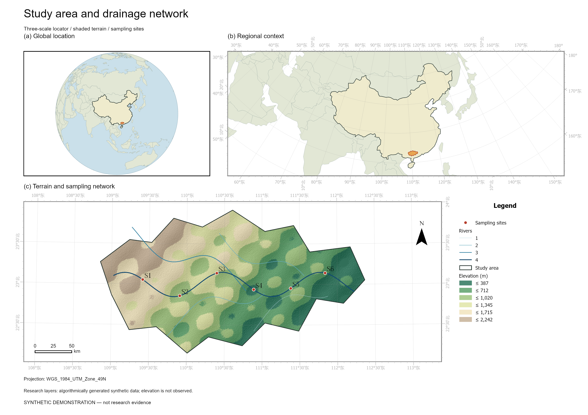
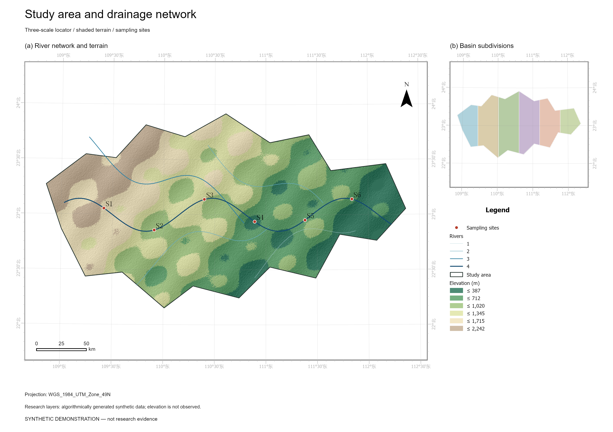

# ArcGIS Paper MCP

**用自然语言驱动 ArcGIS Pro，制作可编辑的论文研究区概况图。**

面向 GIS、地理学、生态学、水文学等科研工作。提供两套布局：

| 模板 | 内容 |
| --- | --- |
| `study_area` | 全球正射定位图＋全国/区域位置图＋研究区地形主图＋独立图例栏 |
| `watershed` | 地形与分级水系主图＋流域分区插图＋独立图例栏 |

支持 DEM 分层设色、地形阴影、边界、行政区、河流分级、采样点及标签；原生经纬网、指北针和动态比例尺；输出 **APRX、PNG、PDF、SVG 和来源/参数清单**。图层和布局可在 ArcGIS Pro 中继续编辑。

> **v0.1 已在 ArcGIS Pro 3.6 实际导出两套模板，并验证独立 ArcGIS Python 的 MCP 连接和水文流程。** 详见 [验证记录](docs/VALIDATION.md)。Pro GUI 快照桥接模式尚待界面验收。合成示例不能作为科研数据。





## 环境

- Windows + 已授权的 **ArcGIS Pro 3.4+**（新增网格等 API 的具体支持取决于版本；缺少样式会写入 warnings）。
- MCP 服务：Python 3.11+，官方 MCP SDK **1.x**。有意约束 `<2`，避免新主版本接口变动。
- ArcPy 由 ArcGIS Pro 自带，**不要 `pip install arcpy`**。ArcPy 后端只使用标准库、ArcPy 及 Pro 自带的 NumPy。
- 制图与 NumPy 地形阴影不要求 Spatial Analyst；**DEM 水系提取需要 Spatial Analyst**。

## 安装 MCP 服务

```powershell
git clone https://github.com/luxun-spec/arcgis-paper-mcp.git
Set-Location arcgis-paper-mcp
uv venv --python 3.11
uv pip install --python .venv/Scripts/python.exe -e .
```

### 方式 A：连接 ArcGIS Pro（项目快照模式）

打开一个 ArcGIS Pro 工程，在 **分析 → Python → Python 窗口** 输入，修改为自己的仓库绝对路径：

```python
import sys
sys.path.insert(0, r"D:\Projects\arcgis-paper-mcp\src")
from arcgis_paper_mcp.bridge import start
start()
```

桥接器在 Pro Python 线程保存当前工程快照，由一个串行工作线程打开快照的明确文件路径并处理任务；**原始工程不会被覆盖**。每次制图生成新的 APRX，完成后在 Pro 打开它继续编辑。若需要纳入当前工程的新改动，请先停止桥接器再 `start()`。停止方法：

```python
from arcgis_paper_mcp.bridge import stop
stop()
```

客户端配置（任何支持 stdio MCP 的客户端；替换绝对路径）：

```json
{
  "mcpServers": {
    "arcgis-paper": {
      "command": "D:/Projects/arcgis-paper-mcp/.venv/Scripts/python.exe",
      "args": ["-m", "arcgis_paper_mcp.server"]
    }
  }
}
```

默认队列是当前用户目录下 `.arcgis-paper-mcp/queue`。可通过两端一致的 `PAPER_MCP_QUEUE` 指定私人本地目录，见 [连接说明](docs/CONNECTION.md)。没有 TCP 监听，不暴露任意 Python 执行工具。

### 方式 B：独立 ArcGIS Python（不打开 Pro 界面）

在客户端配置中添加：

```json
"env": {
  "PAPER_MCP_ARCGIS_PYTHON": "C:/Program Files/ArcGIS/Pro/bin/Python/envs/arcgispro-py3/python.exe",
  "PYTHONPATH": "D:/Projects/arcgis-paper-mcp/src",
  "PAPER_MCP_TIMEOUT": "600"
}
```

配置 JSON 中必须提供现有 `project` APRX 作为只读种子。后端每次以独立 ArcGIS Python 进程运行；不向 Pro 自带环境安装 MCP 包。若克隆了 Pro 环境，使用克隆环境的 Python。

## 开始制图

复制 [examples/study_area.json](examples/study_area.json)，修改数据路径、输出目录和投影，然后让 AI：

> “检查 ArcGIS 连接和我的数据，用 D:/research/study_area.json 制作论文区域概况图，导出 PNG、PDF 和可编辑工程；报告数据来源和所有 warnings。”

也可以直接用 ArcGIS Python 命令行（示例用自定义安装路径，请替换）：

```powershell
$env:PYTHONPATH = (Resolve-Path src).Path
& 'C:/Program Files/ArcGIS/Pro/bin/Python/envs/arcgispro-py3/python.exe' -m arcgis_paper_mcp.cli render 'D:/research/study_area.json'
```

`boundary` 和 `output_dir` 必填；三级定位推荐额外提供 `world`、`country`、`dem`、`rivers`。没有世界边界时只显示研究区定位，**不会自动下载或编造边界**。`project` 在独立模式必填，桥接模式可省略。相对数据路径基于 JSON 文件所在目录解析。完整字段见 [配置说明](docs/CONFIGURATION.md)。

生成的文件：

```text
新输出目录/
  study_area.aprx       # 原生地图、布局与图层
  study_area.png        # 或 watershed.png
  study_area.pdf
  study_area.svg       # 配置 formats 启用
  elevation.tif        # 裁剪 DEM（有 DEM 时）
  hillshade.tif        # 显示用地形阴影
  manifest.json        # 输入、CRS、参数、输出、警告
```

APRX 保留种子工程原有项目项，并添加唯一名称的论文布局；用户提供的矢量数据保留路径引用。移动工程时需一起移动或重新连接原始数据，APRX 不是自动打包的地图包。

## DEM 水系提取

```text
derive_watershed(dem_path="D:/data/dem_utm.tif", output_dir="D:/research/hydrology-new", threshold_km2=20)
```

执行填洼、D8 流向、汇流累积、Strahler 分级、水系矢量化和 Basin 分区。输入 DEM 必须已投影到**米**；阈值按实际像元面积换算。参数不能照抄参考图，须根据 DEM 分辨率和研究尺度确定。DEM 应覆盖完整上游汇水范围，不能先按狭窄行政边界裁掉上游。

`Basin` 产出 DEM 边缘出口对应的流域，**不等同于按指定出口点划分的子流域**。不会自动套用参考图上的“≥5000 km²”分区筛选。输出 `rivers.shp` 的 `grid_code` 字段可用于 `river_order_field`；查看实际字段确认。

## 合成示例

```powershell
$env:PYTHONPATH = (Resolve-Path src).Path
& 'C:/Program Files/ArcGIS/Pro/bin/Python/envs/arcgispro-py3/python.exe' -m arcgis_paper_mcp.cli demo 'D:/paper-demo' --project 'D:/seed.aprx' --world 'D:/data/world.shp' --country 'D:/data/country.shp'
```

`world` / `country` 可省略。示例会生成明确标注为 **SYNTHETIC DEMONSTRATION** 的地形、边界、河流、分区、采样点及两份配置；河流、分区是算法构造的示意对象，非真实水文分析结果。然后分别 `render` 两份配置。

## 开发与限制

```powershell
uv pip install --python .venv/Scripts/python.exe -e .
.venv/Scripts/python.exe -m unittest discover -s tests -v
```

CI 检查纯 Python 逻辑与真实 stdio MCP 协议；GitHub 托管运行器没有 ArcGIS 授权，不能替代本地 ArcGIS 验收。字号、色带、图例和布局可在输出 APRX 中精修；v0.1 没有任意布局编辑工具、自动地名检索、海量 DEM 分块分析或出口点交互划分。大任务超时后先检查输出目录，避免重复提交；未领取任务会取消，已执行的 ArcPy 工作不会被强杀。

只有新建/空输出目录可用。使用私人队列目录且每个队列只运行一个桥接器；本机拥有该目录写权限的程序可提交允许的制图任务。不要把队列放在共享盘。

技术依据：[Esri ArcGISProject API](https://pro.arcgis.com/en/pro-app/latest/arcpy/mapping/arcgisproject-class.htm)、[MapFrame API](https://pro.arcgis.com/en/pro-app/latest/arcpy/mapping/mapframe-class.htm)、[官方 MCP Python SDK v1](https://github.com/modelcontextprotocol/python-sdk/tree/v1.x)。参考图仅用于需求沟通，未随仓库再分发。

MIT License。ArcGIS、地图数据和字体各自遵循原授权。
